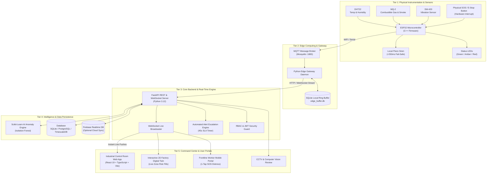
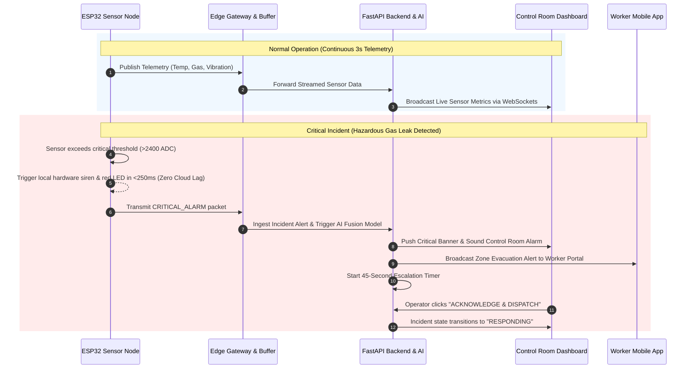
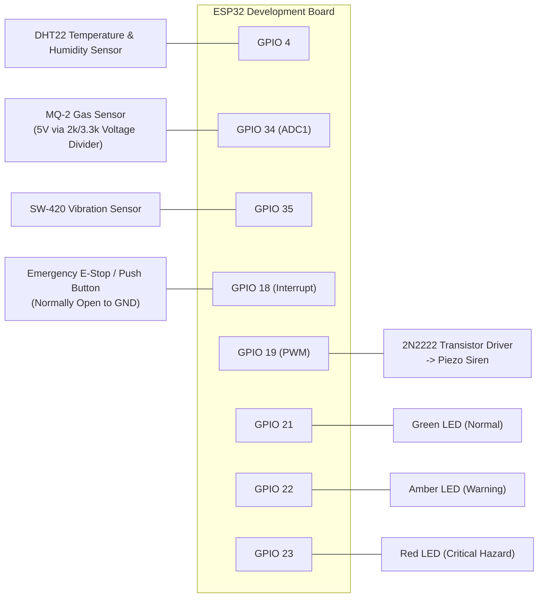

# SMART INDUSTRY 360 🏭⚡
> **Intelligent IoT- & AI-Enabled Industrial Safety, Emergency Response, and Real-Time Plant Monitoring System**

[](https://python.org)
[](https://fastapi.tiangolo.com)
[](https://react.dev)
[](https://typescriptlang.org)
[](https://mqtt.org)
[](https://docker.com)
[](LICENSE)

---

## 📌 1. What is Smart Industry 360?

**Smart Industry 360** is an all-in-one industrial safety and plant intelligence system. It bridges physical factory sensors, edge computing hardware, artificial intelligence, and human safety operators into a unified real-time dashboard.

In simple terms:
- 📡 **Collects Real-Time Sensor Data**: Constantly monitors temperature, toxic/combustible gases, mechanical vibration, and machine health across factory production lines.
- ⚡ **Zero-Latency Emergency Response**: If hazardous gas leaks or thermal spikes occur, local edge hardware triggers alarms and sirens in **under 250 milliseconds**—even if the internet or central server goes offline.
- 🤖 **AI Predictive Anomaly Detection**: Uses machine learning to detect equipment degradation and hidden safety hazards before catastrophic breakdowns happen.
- 🚨 **Automated Incident Escalation**: Manages emergency lifecycles (`NEW` → `ACKNOWLEDGED` → `RESPONDING` → `CONTAINED` → `RESOLVED`) with an automated 45-second escalation timer and live evacuation route updates.
- 📱 **Role-Based Control**: Tailored portals for 8 specialized operational roles—from executive control-room operators and safety officers to frontline workers with 1-tap mobile SOS distress buttons.

---

## 🏗️ 2. System Architecture & Block Diagrams

### 🌐 High-Level 5-Tier Architecture
The diagram below illustrates how raw sensor signals move from physical factory hardware up to the cloud and command dashboard:



---

### ⏱️ Real-Time Telemetry & Emergency Escalation Flow
Here is the sequence of events during continuous monitoring and critical incidents:



---

### 🔌 Hardware Pinout & Wiring Block Diagram

For hardware prototyping with an ESP32 microcontroller:



---

## 💻 3. Technology Stack

| Layer | Technologies & Frameworks | Purpose |
| :--- | :--- | :--- |
| **Frontend** | React 19, TypeScript, Vite, Tailwind CSS v4, Lucide Icons, Recharts, React Router v7 | Responsive command center UI, real-time charts, 2D floor plans |
| **Backend** | Python 3.12, FastAPI, Pydantic v2, SQLAlchemy 2.0, Uvicorn, WebSockets | Asynchronous high-throughput REST API and bi-directional live feeds |
| **Edge & Messaging** | MQTT (Mosquitto 1883), Python Edge Gateway, SQLite Local Ring Buffer | Sub-millisecond sensor ingest and offline resilience (`edge_buffer.db`) |
| **Machine Learning** | Scikit-Learn Isolation Forest, Rolling Z-Score vectors | Anomaly scoring, sensor fusion risk index, remaining useful life (RUL) |
| **Firmware** | C++ Arduino ESP32 (`smart_industry_esp32.ino`), Hardware Interrupts | Low-level sensor ADC sampling, autonomous fail-safe triggers |
| **Deployment** | Docker, Docker Compose, Nginx Reverse Proxy | Production containerization and service orchestration |

---

## 🚀 4. Quick Start Guide

### Option A: Using Docker (Fastest)

Run the entire platform (backend, frontend, database, and edge simulator) in one command:

```bash
# Clone the repository
git clone https://github.com/DipendaMahato/SMART-INDUSTRY-360.git
cd SMART-INDUSTRY-360

# Launch all microservices
docker compose -f deployment/docker-compose.yml up --build
```
- **Control Center Dashboard**: [http://localhost:5173](http://localhost:5173)
- **FastAPI Interactive Docs**: [http://localhost:8000/docs](http://localhost:8000/docs)

---

### Option B: Local Manual Setup (Without Docker)

#### Prerequisites
- **Python**: 3.12 or higher
- **Node.js**: 20 or higher & npm

#### Step 1: Start the Backend
```powershell
# Open terminal in project root
cd "d:\Smart Industry 360"

# Install Python requirements
pip install -r requirements.txt

# Start FastAPI with Uvicorn
uvicorn backend.main:app --host 127.0.0.1 --port 8000 --reload
```
> *On initial startup, `smart_industry.db` is generated and seeded automatically, and the real-time plant telemetry simulator starts immediately.*

#### Step 2: Start the Frontend
In a new terminal window:
```powershell
cd "d:\Smart Industry 360\frontend"

# Install dependencies
npm install

# Start development server
npm run dev
```
Open **[http://localhost:5173](http://localhost:5173)** in your browser.

---

## 🔑 5. Pre-Configured Evaluation Accounts

The platform automatically provisions 8 standard industrial roles. Use these accounts to evaluate different permission tiers:

| Role | Username | Password | Purpose & Access Scope |
| :--- | :--- | :--- | :--- |
| **Super Administrator** | `superadmin` | `Admin@123` | Full system governance, RBAC permissions, audit inspection |
| **Plant Administrator** | `plantadmin` | `Plant@123` | Plant facility configuration, zone limits, work order dispatch |
| **Control-Room Operator**| `operator` | `Operator@123` | Live telemetry monitoring, incident lifecycle, remote alarms |
| **Safety Officer** | `safety` | `Safety@123` | Emergency escalation, evacuation management, muster tracking |
| **Security Personnel** | `security` | `Security@123` | CCTV stream monitoring, AI human/PPE detection review |
| **Maintenance Engineer** | `maintenance` | `Maint@123` | Rotating machinery vibration, RUL analysis, preventive maintenance |
| **Frontline Worker** | `worker` | `Worker@123` | Worker portal, personal hazard reports, 1-tap SOS distress button |
| **Auditor** | `auditor` | `Auditor@123` | Read-only compliance review, immutable tamper-evident logs |

> 💡 **Quick Login**: The `/login` page includes **1-click login buttons** for all roles to facilitate rapid evaluation.

---

## 🎛️ 6. Core Modules & Capabilities

### 1. 🏭 Factory Digital Twin (`/app/digital-twin`)
Interactive 2D schematic floor plan of the manufacturing plant. Zones dynamically change colors based on real-time sensor metrics:
- 🟢 **CLEAR**: Safe baseline parameters.
- 🟡 **WARNING**: Parameter drifting above threshold.
- 🔴 **EVACUATE**: Hazardous gas leak, extreme heat, or emergency SOS active.

### 2. 🚨 Emergency Center & Escalation Engine (`/app/emergency`)
Enforces a 5-stage formal incident state machine:
$$\text{NEW} \longrightarrow \text{ACKNOWLEDGED} \longrightarrow \text{RESPONDING} \longrightarrow \text{CONTAINED} \longrightarrow \text{RESOLVED}$$
- **45-Second SLA Timer**: If an operator does not acknowledge a critical alert within 45 seconds, the system automatically escalates notifications to safety directors and facility managers.

### 3. 🧠 AI Anomaly Intelligence (`/app/ai-intelligence`)
- Powered by an **Isolation Forest** unsupervised learning model.
- Analyzes multi-dimensional sensor vectors (Temperature, Humidity, Gas PPM, RMS Vibration, Spike Counts) to identify anomalies before physical failures happen.
- Includes an **Explainability Reason Code** (e.g., `THERMAL_AEROSOL_CONCOMITANT_SIGNATURE`).

### 4. 📹 CCTV & Security Verification (`/app/cctv`)
- Monitors RTSP camera feeds across high-risk zones.
- Captures automated AI computer-vision flags (PPE violations, unauthorized zone entry, smoke visual signatures).
- Includes a mandatory human verification protocol (`CONFIRM` / `DISMISS`).

### 5. 📱 Frontline Worker Mobile Portal (`/worker`)
- High-contrast, mobile-friendly interface designed for rugged handhelds or smartphones.
- **1-Tap Emergency SOS Distress Button** with a 5-second accidental press cancellation countdown.
- Real-time evacuation broadcast notifications with designated safe muster points.

---

## 🧪 7. Interactive Edge Simulator

Test the entire safety loop from your browser without physical hardware! Open the **Simulator Drawer** (floating button in the dashboard) to trigger real-time simulated scenarios:

1. **Combustible Gas & Smoke Leak**: Injects hazardous hydrocarbon concentrations into Zone 2.
2. **Thermal Runaway**: Ramps reactor temperatures past 85°C.
3. **Spindle Vibration Spike**: Simulates severe mechanical imbalance on CNC milling machines.
4. **Worker SOS Distress**: Simulates an operator down emergency.
5. **Edge Gateway Severing**: Cuts connection to demonstrate autonomous local hardware sirens and edge SQLite buffering (`edge_buffer.db`).
6. **Gateway Reconnect**: Restores communication and synchronizes stored packets without data loss.
7. **Reset Baseline**: Instantly returns all plant zones to safe nominal conditions.

---

## 📂 8. Repository Structure

```
SMART-INDUSTRY-360/
├── backend/                  # FastAPI Application Core
│   ├── routers/              # 17 Modular REST & WebSocket API Routers
│   ├── ai_engine.py          # Scikit-Learn Isolation Forest & Sensor Fusion
│   ├── auth.py               # JWT Authentication & Password Hashing
│   ├── config.py             # App Environment Settings
│   ├── database.py           # SQLAlchemy Database Session Setup
│   ├── firebase_admin.py     # Firebase Realtime DB Cloud Sync
│   ├── main.py               # Application Entry Point & Lifespan Tasks
│   ├── models.py             # Database Schema (Users, Incidents, Telemetry)
│   ├── notifications_engine.py # Multi-channel Outbox & 45s Escalation
│   ├── schemas.py            # Pydantic v2 Request/Response Models
│   ├── simulator.py          # Industrial Plant Telemetry Simulation Loop
│   └── websocket_manager.py  # Real-Time WebSocket Connection Pool
├── database/                 # Seed Scripts & Initial Records
│   ├── firebase_realtime_seed.json
│   └── seed_data.py          # Auto-seeds 8 Roles, Plants, Zones, Equipment
├── deployment/               # Containerization & Infrastructure
│   ├── Dockerfile.backend
│   ├── Dockerfile.frontend
│   ├── docker-compose.yml    # Single-command Full-Stack Deployment
│   └── nginx.conf            # Nginx Reverse Proxy Config
├── frontend/                 # React 19 Frontend Web Application
│   ├── public/               # Static Icons and Assets
│   ├── src/
│   │   ├── components/       # Reusable UI (Header, Sidebar, Simulator)
│   │   ├── context/          # Auth and WebSocket Real-Time Context
│   │   ├── pages/
│   │   │   ├── app/          # 18 Control-Room Operational Dashboard Pages
│   │   │   ├── public/       # Public Marketing & Architecture Pages
│   │   │   └── worker/       # Frontline Worker Mobile SOS Portal
│   │   ├── services/         # REST API & Firebase Client Integrations
│   │   └── types/            # TypeScript Interface Definitions
│   ├── package.json
│   └── vite.config.ts
├── iot/                      # Firmware & Edge Gateway
│   ├── esp32-firmware/
│   │   ├── WIRING_AND_PINOUT.md
│   │   └── smart_industry_esp32.ino # C++ ESP32 Firmware with Fail-Safe
│   └── mqtt-gateway/
│       └── edge_gateway.py   # Python Edge Daemon with SQLite Store-and-Forward
├── tests/                    # Automated Test Suites
│   └── test_api.py           # Pytest API, Auth, Telemetry, and AI Tests
├── .env.example              # Sample Environment Variables
├── .gitignore                # Git Exclusions (Secrets, Builds, Databases)
├── pytest.ini                # Pytest Configuration
├── requirements.txt          # Python Dependencies
└── README.md                 # Complete System Documentation
```

---

## 🚦 9. Running Automated Tests

Run the test suite to verify API endpoints, authentication, incident state transitions, and AI model anomaly scores:

```powershell
pytest -v
```

All test cases validate:
- ✅ REST API health check
- ✅ JWT authentication & invalid credential rejection
- ✅ Dashboard summary KPI aggregations
- ✅ Telemetry ingestion & engineering limit evaluations
- ✅ Incident state machine transitions (`NEW` → `ACKNOWLEDGED` → `RESOLVED`)
- ✅ AI Isolation Forest anomaly scoring & sensor fusion risk indexes

---

## ⚠️ 10. Engineering & Safety Notice

> [!NOTE]
> **Prototype Instrumentation Notice**: The ESP32 firmware sketch and educational sensor modules (MQ-2, DHT22, SW-420) in this repository are developed for engineering demonstrations, algorithmic evaluation, and academic research. Certified industrial deployments in classified hazardous locations (Class I, Div 1/2 or ATEX Zones 0/1/2) must integrate certified intrinsically safe, SIL-rated Safety Instrumented Systems (SIS).

---

## 📄 License
This project is licensed under the **MIT License**.
